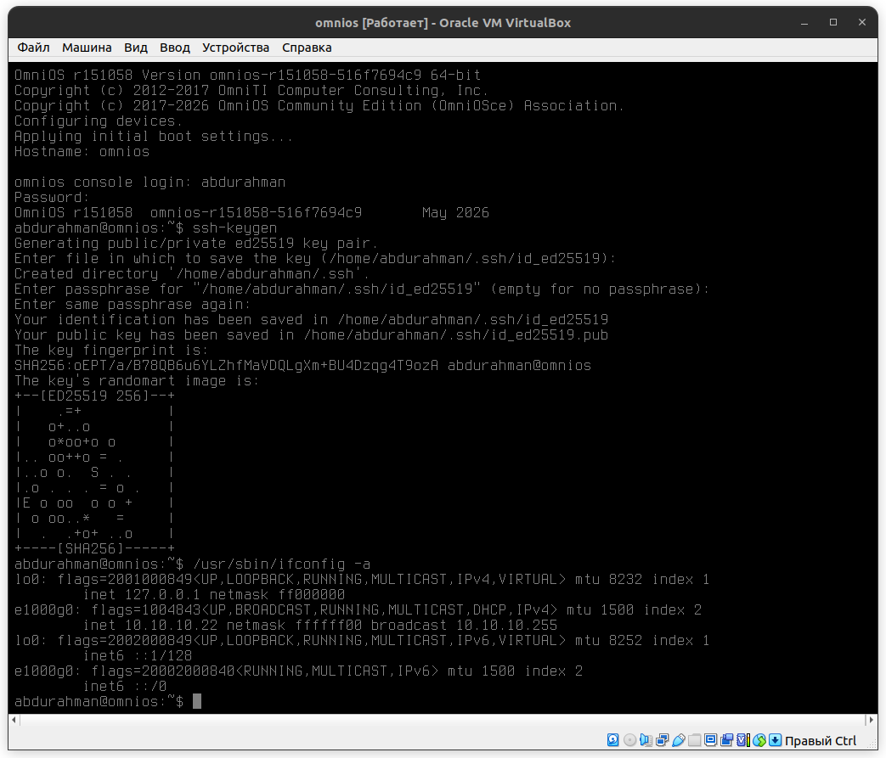
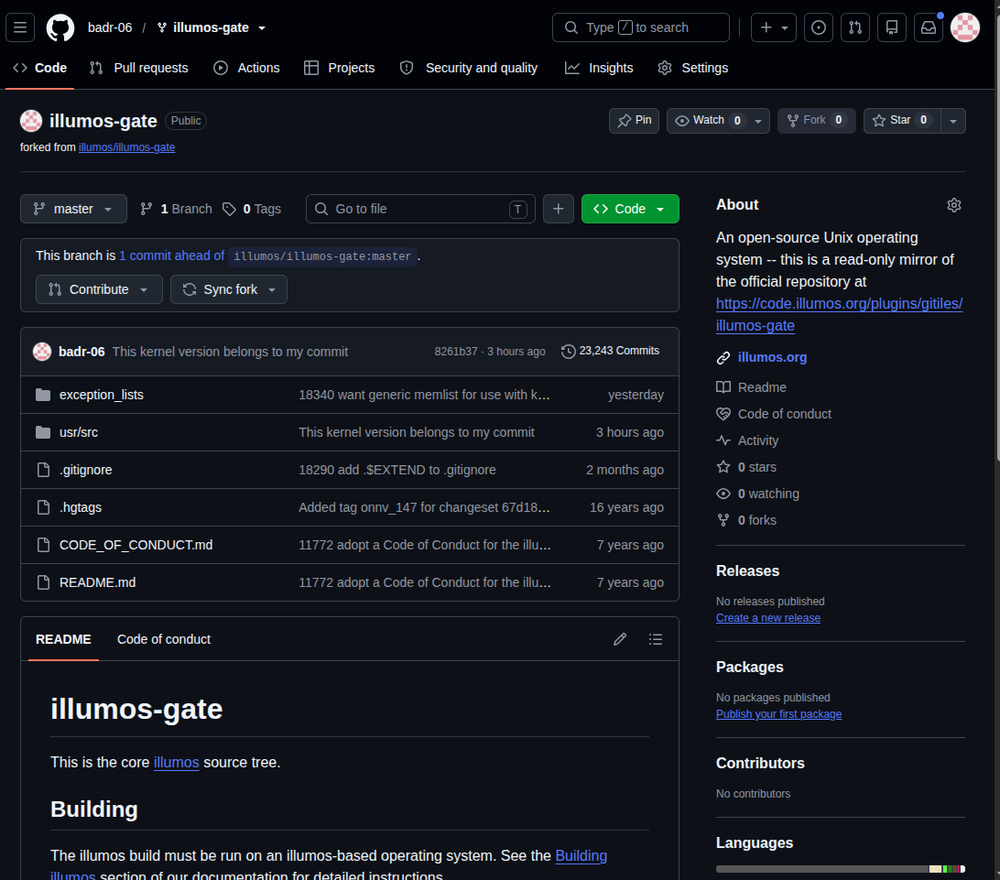
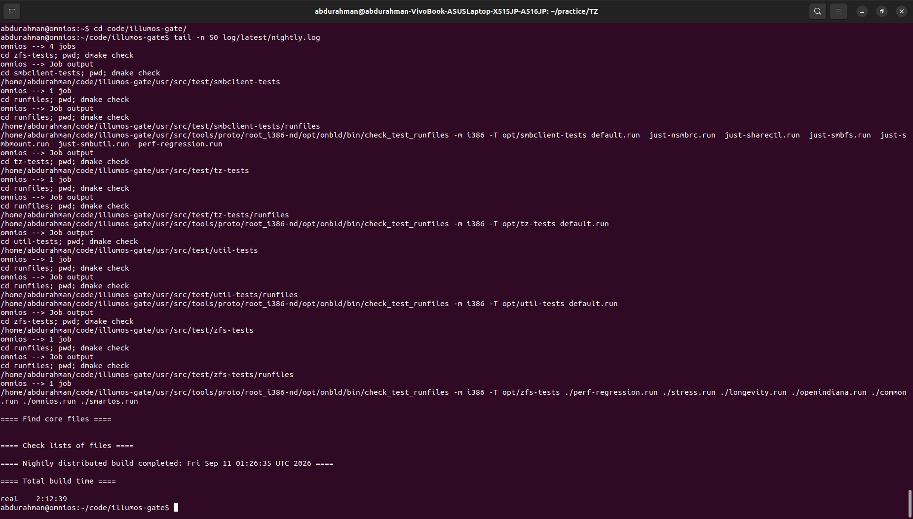
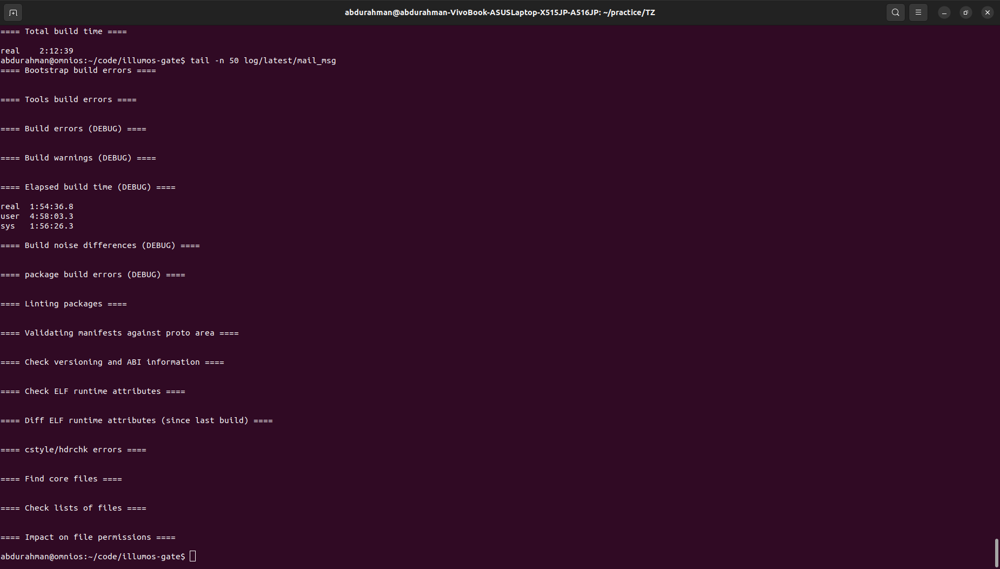
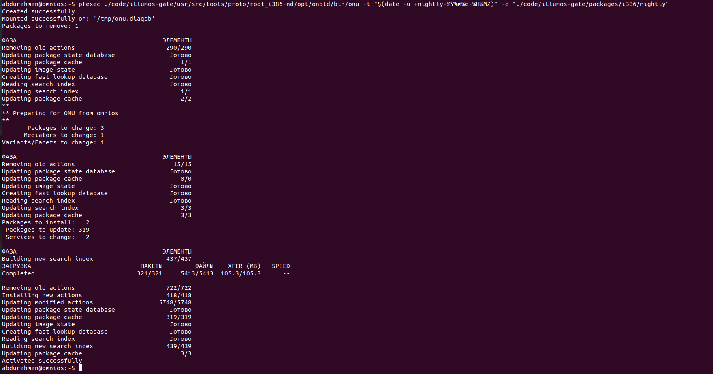
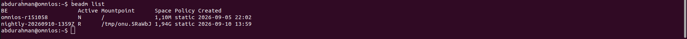
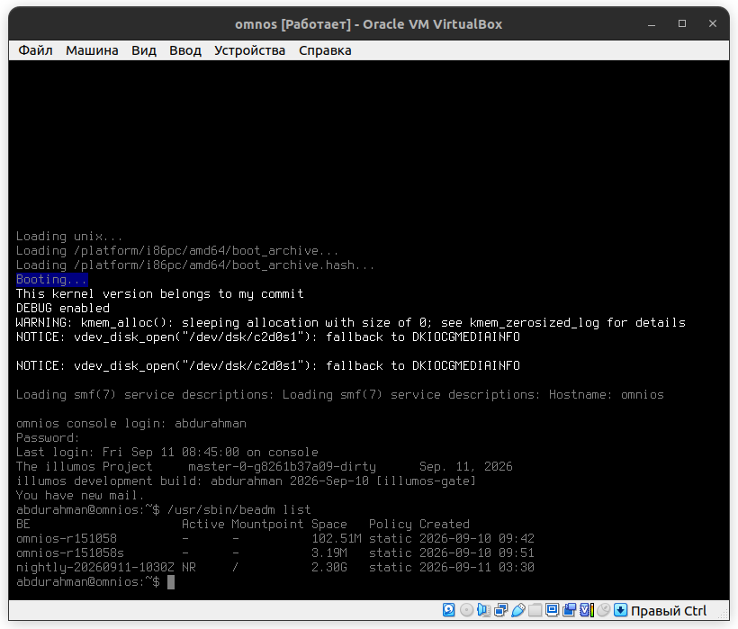
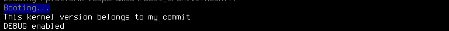

## Задание
- внести незначительное изменение в git проект ядра и собрать ядро illumos (дистрибутив на усмотрение кандидата)
- запустить систему с собранным ядром, так, чтобы новый коммит был виден при загрузке

### Пункт 1
Изначально я скачал дистрибутив omnios и поднял его на виртуальной машине.
https://illumos.org/docs/developers/build/ на оффициальном сайте было сказано
***Для сборки illumos необходима операционная система на базе illumos. Кросс-компиляция не поддерживается.***

Настроил все полностью, сгенерировал ssh ключ для клонирования репы.
Также включил dhcp для подлкючения по ssh.

### Пункт 2
Нашел репозиторий проекта Ядра **illumos** ***https://github.com/illumos/illumos-gate*** и сделал форк в свой Github.

### Пункт 3
Нашел Файл и строку которая отвечает за показ баннера при включение системы, поменял на строку ***This kernel version belongs to my commit*** который также указал при новом коммите.

### Пункт 4
Сборку делал по инструкции из **https://illumos.org/docs/developers/build/#configuring-the-build** указанной в **illumos-gate** с некоторыми изменениями.
#### Логи после начльной сборки, запущенной командой ***time ./usr/src/tools/scripts/nightly illumos.sh***

#### Устанавил сборку с помощью утилиты **onu**

#### Потверждении того что ядро собралось

### Пункт 5
Полседний пункт, делаем ***reboot*** для переключения на нашу сборку
и видим при входе в систему вывод нашего баннера

